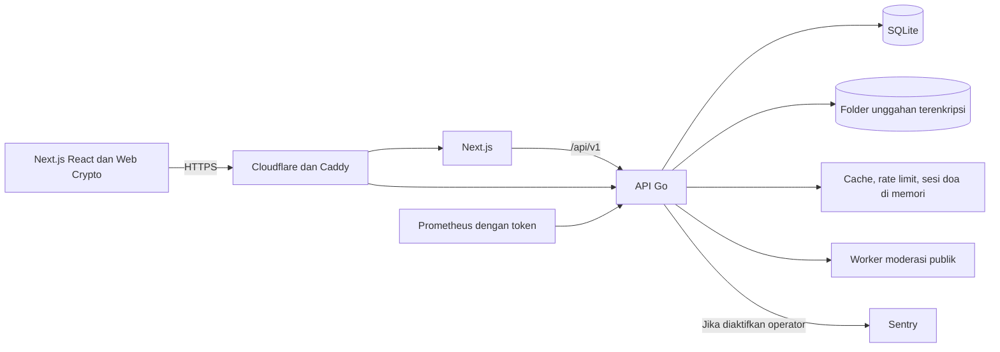

# Untukmu

Website untuk menyimpan pesan dan kenangan dalam galaksi, membaca pesan publik anonim, serta memberi empati dan dukungan melalui rekaman doa terkurasi. Acuan produk asli: [PRD Kelompok 8](docs/PRD.docx).

Panduan penggunaan, konfigurasi lokal, pengembangan, dan katalog disatukan di README ini. Panduan operator berada di [Operasional produksi](docs/PRODUKSI.md); atribusi tetap berada di [pemberitahuan pihak ketiga](THIRD-PARTY-NOTICES.md).

## Daftar isi

- [Teknologi](#teknologi)
- [Menjalankan secara lokal](#menjalankan-secara-lokal)
- [Bima Sakti dan ruang](#bima-sakti-dan-ruang)
- [Fitur dan privasi pesan](#fitur-dan-privasi-pesan)
- [Tombol Berikan empati](#tombol-berikan-empati)
- [Doa dan kurasi audio](#doa-dan-kurasi-audio)
- [Panel admin](#panel-admin)
- [Struktur proyek](#struktur-proyek)
- [Arsitektur dan keamanan data](#arsitektur-dan-keamanan-data)
- [Format dan pengujian](#format-dan-pengujian)
- [Persiapan deploy dan backup](#persiapan-deploy-dan-backup)

## Teknologi

| Bagian          | Teknologi                                                                          |
| --------------- | ---------------------------------------------------------------------------------- |
| Frontend        | Next.js 16 App Router, React 19, TypeScript, Tailwind CSS                          |
| Visual kenangan | Three.js, React Three Fiber; controller visual berada dalam sumber frontend        |
| State dan data  | Zustand, TanStack Query                                                            |
| Backend         | Go 1.26, `net/http`, satu biner API dengan worker moderasi di dalamnya             |
| Database        | PostgreSQL (Neon) lewat `DATABASE_URL`; SQLite lokal bila kosong; migrasi otomatis |
| Berkas          | Folder lokal dengan URL bertanda tangan; lampiran pribadi dienkripsi di perangkat  |
| Infrastruktur   | Tanpa Docker; Caddy dan Turnstile untuk produksi; Sentry/Prometheus opsional       |
| Pemeriksaan     | ESLint, TypeScript, Prettier, gofmt, `go vet`, `go test`, Vitest, Playwright       |

## Menjalankan secara lokal

### 1. Siapkan perangkat dan proyek

- Pasang **[Go 1.26+](https://go.dev/dl/)** dan **[Node.js 22+](https://nodejs.org/)** (beserta npm). Bila Go yang terpasang lebih lama, perintah `go` mengunduh toolchain yang sesuai secara otomatis.
- Unduh/clone repositori ini, lalu buka terminal pada folder yang berisi `README.md` dan `.env.example`.
- Pastikan port `3000` (frontend) dan `8000` (API) belum dipakai aplikasi lain.

**Tidak perlu Docker, PostgreSQL, Redis, MinIO, atau Python.** Database SQLite dan folder unggahan dibuat otomatis di `backend/var/`.

Periksa dari terminal yang sama:

```sh
go version
node --version
```

### 2. Buat `.env`

Jalankan dari akar proyek:

```sh
cd backend
go run ./cmd/untukmu init-env
cd ..
```

Perintah membuat file **`.env` di akar proyek** dengan kunci acak. Setiap orang yang mencoba proyek membuat `.env` miliknya sendiri. `.env.example` hanya template. Jika muncul **`.env sudah ada; tidak diubah.`**, konfigurasi lama sengaja dipertahankan; `.env` lama dari versi Docker tetap bisa dipakai karena variabel yang tidak dikenal diabaikan.

Jangan unggah `.env` ke Git atau membagikannya dalam tangkapan layar. Peran setiap nilai:

| Variabel                                        | Fungsi                                                                                                            |
| ----------------------------------------------- | ----------------------------------------------------------------------------------------------------------------- |
| `ENVIRONMENT`                                   | `development` untuk lokal; `production` mengaktifkan pemeriksaan HTTPS/Turnstile yang lebih ketat.                |
| `APP_ORIGIN`                                    | Alamat aplikasi di browser; lokal `http://localhost:3000`. Permintaan tulis dari origin lain ditolak.             |
| `LISTEN_ADDR`, `API_INTERNAL_URL`               | Alamat API Go (`127.0.0.1:8000`) dan tujuan proxy `/api/v1` dari Next.js.                                         |
| `DATABASE_URL`                                  | PostgreSQL, mis. Neon (`postgresql://…?sslmode=require`). Kosong = SQLite lokal di `DATABASE_PATH`.               |
| `DATABASE_PATH`, `STORAGE_DIR`                  | Lokasi berkas SQLite dan unggahan terenkripsi, relatif terhadap folder `backend`. Backup keduanya bersama `.env`. |
| `JWT_SECRET`, `PUBLIC_CONTENT_KEY`              | Kunci sesi dan penyimpanan pesan publik; dibuat otomatis. Jangan diganti pada instalasi yang sudah berisi data.   |
| `TRUSTED_PROXIES`                               | Proxy yang boleh mengirim `X-Forwarded-For` (bawaan loopback: Next.js/Caddy di mesin yang sama).                  |
| `TURNSTILE_*`, `NEXT_PUBLIC_TURNSTILE_SITE_KEY` | Boleh kosong untuk lokal dengan `ENVIRONMENT=development`; wajib pada produksi.                                   |
| `SENTRY_DSN`, `METRICS_TOKEN`                   | Opsional: pelaporan kesalahan tanpa data pesan, dan token endpoint `/metrics` untuk Prometheus.                   |
| `SITE_DOMAIN`                                   | Kosong untuk lokal; hostname tanpa skema untuk Caddy produksi.                                                    |

### 3. Jalankan API dan frontend

Pasang dependensi frontend sekali:

```sh
npm ci
```

Terminal pertama — API Go (dari akar proyek):

```sh
npm run api
```

Terminal kedua — frontend:

```sh
npm run dev
```

`npm run api` sama dengan `cd backend && go run ./cmd/untukmu`. API membuat skema database dan mengisi katalog doa saat pertama berjalan. Buka http://localhost:3000/api/v1/health; hasil yang diharapkan memuat `"status":"ok"`. Kemudian buka aplikasi:

| Halaman     | Alamat                      |
| ----------- | --------------------------- |
| Aplikasi    | http://localhost:3000       |
| Doa         | http://localhost:3000/doa   |
| Panel admin | http://localhost:3000/admin |

Untuk mode produksi lokal: `npm run build`, `npm run api:build`, lalu jalankan `backend/untukmu` (dari folder `backend`) dan `npm start`.

Tidak ada akun aplikasi bawaan. Buat akun melalui aplikasi seperti langkah berikut.

### 4. Buat akun dan coba pesan publik dari akun lain

1. Buka http://localhost:3000, pilih **Mulai Menulis** atau **Tulis**, lalu **Daftar akun** saat formulir masuk muncul.
2. Isi surel dan kata sandi minimal **12 karakter**, ulangi kata sandi, lalu pilih **Daftar**. Simpan kode pemulihan yang ditampilkan di tempat aman.
3. Sebagai **akun A**, pilih tujuan/nama kenangan, bentuk galaksi, lalu isi pesan sederhana, misalnya `Semoga hari ini membawa kabar baik`. Pada pilihan pembaca, pilih **Publik anonim**, kosongkan jadwal pembukaan untuk uji ini, lalu **Simpan sebagai bintang**.
4. Buka browser lain atau jendela privat/incognito, akses **alamat aplikasi yang sama**, lalu daftar/masuk sebagai **akun B** dengan surel berbeda. Dua tab biasa dalam browser yang sama berbagi cookie dan bukan dua sesi akun yang terpisah.
5. Akun B harus dapat melihat galaksi yang memiliki pesan publik milik akun A di langit, serta membaca pesan itu melalui **Jelajah** dan memilihnya di **Doa**. Jika aplikasi sudah dibuka sebelum pesan dibuat, muat ulang halaman/daftar agar mengambil data terbaru. Ulangi tanpa login untuk memeriksa akses pengunjung.
6. Buat pesan kedua sebagai akun A dengan pilihan **Privat**. Pesan privat tersebut hanya dapat dibuka oleh akun A; akun B tetap hanya menerima pesan yang dipublikasikan.

Pesan publik harus lolos pemeriksaan awal dan sudah mencapai waktu pembukaan. Pesan yang ditandai untuk moderasi menunggu peninjauan admin. Nama pribadi tujuan, foto, lampiran, dan isi privat tidak ikut dibagikan lewat galaksi publik. **Ruang Pribadi** tetap berisi data milik akun yang sedang masuk.

Semua akun harus mengakses server/instalasi yang sama agar berbagi pesan publik. Menjalankan salinan terpisah di dua komputer menghasilkan database terpisah; `localhost` pada masing-masing komputer menunjuk komputer itu sendiri.

**Refresh halaman tetap mempertahankan login** selama cookie dan sesi akun masih valid. Cookie sesi memiliki masa berlaku bawaan 30 hari dan diperpanjang saat token sesi diperbarui. Login ulang diperlukan setelah sesi berakhir/dicabut atau cookie dihapus. **Keluar/Ganti akun** mencabut sesi yang sedang digunakan.

Sesudah refresh, akun tetap masuk, tetapi kunci enkripsi privat perlu dibuka kembali: pilih tombol **Kunci** (ikon kunci), masukkan kata sandi akun, lalu **Buka kunci**. Ini diperlukan untuk membaca/menulis pesan privat, membuka lampiran, atau mengekspor data; pesan publik dan galaksi tetap dapat dijelajahi. Kata sandi dan kunci enkripsi tidak disimpan di penyimpanan browser agar kunci tidak menetap setelah halaman ditutup.

### 5. Melihat database, menghentikan, dan menjalankan kembali

Database berada di `backend/var/untukmu.db` (atau `DATABASE_PATH`). Buka dengan [DB Browser for SQLite](https://sqlitebrowser.org/) atau `sqlite3` secara **baca saja** saat API berjalan. Tabel utama: `users`, `messages`, `constellations`, `prayers`, dan `prayer_contents`. Berkas unggahan terenkripsi berada di `backend/var/storage`.

Hentikan API dan frontend dengan `Ctrl+C` di masing-masing terminal. Data tetap tersimpan; jalankan kembali perintah langkah 3. Menghapus folder `backend/var` menghapus seluruh akun, pesan, dan unggahan lokal.

### Jika belum berhasil

| Kendala                                         | Yang perlu diperiksa                                                                                                                                                                              |
| ----------------------------------------------- | ------------------------------------------------------------------------------------------------------------------------------------------------------------------------------------------------- |
| `go`/`node` tidak dikenali                      | Pastikan sudah terpasang dan buka ulang terminal.                                                                                                                                                 |
| `JWT_SECRET wajib acak dan minimal 32 karakter` | `.env` belum dibuat atau masih berisi nilai template. Jalankan `go run ./cmd/untukmu init-env` dari folder `backend`.                                                                             |
| Address already in use                          | Hentikan aplikasi lain yang memakai port `8000`/`3000`, atau ubah `LISTEN_ADDR` dan `API_INTERNAL_URL` bersamaan.                                                                                 |
| Halaman memuat tetapi API gagal (502/500)       | Pastikan terminal API masih berjalan dan `API_INTERNAL_URL` menunjuk alamat yang sama dengan `LISTEN_ADDR`.                                                                                       |
| Pesan A belum terlihat pada akun B              | Pastikan server sama, pilihan **Publik anonim**, jadwal sudah terbuka, moderasi sudah disetujui, filter Jelajah dikosongkan, dan tidak ada blokir antar akun. Muat ulang setelah menyimpan pesan. |
| Tampilan masih seperti sebelum pembaruan        | Hentikan lalu jalankan ulang `npm run dev`, kemudian muat ulang paksa browser (`Ctrl+Shift+R`).                                                                                                   |

## Bima Sakti dan ruang

Ruang utama hanya berisi Bima Sakti — dilukis di GPU seperti [galaxy-explorer](https://github.com/zjoooooo/galaxy-explorer): sapuan kuas mengikuti aliran spiral, jalur debu gelap, inti krem keemasan, dan bintang partikel yang berkilau saat didekati. Setiap akun otomatis mendapat satu **ruang** beserta "Galaksi pertamaku" saat mendaftar. Ruang itu adalah satu butir cahaya di lengan Bima Sakti, bagian dari debu bintang yang ikut berputar mengorbit pusat galaksi.

- Setelah masuk, kamu langsung berada di ruangmu sendiri. Pilih **Ke Bima Sakti** pada bilah ruang, atau gulir menjauh sampai batas zoom, untuk keluar: kamera muncul dari antara debu di dekat butir ruangmu lalu mundur sampai seluruh Bima Sakti terlihat.
- Di ruang utama kamera hanya bisa diputar dan didekatkan; tidak bisa mundur atau digeser, jadi fokusnya selalu Bima Sakti.
- Arahkan kursor ke butir di lengan galaksi untuk melihat ruangnya. Butir emas adalah ruangmu, butir biru-putih adalah ruang publik yang bisa dimasuki (klik untuk menyelam ke dalamnya), dan butir redup adalah ruang privat.
- Ruang baru selalu **privat**. Pilih **Buka untuk umum** pada bilah ruang (atau Pengaturan → Ruangmu di Bima Sakti) agar orang lain bisa masuk. Pengunjung melihat nama ruang, nama dan bentuk galaksi, serta pesan publik yang sudah disetujui; pesan privat, tautan terbatas, foto, dan lampiran tetap terenkripsi.
- Nama ruang dapat diganti lewat **Ganti nama** pada bilah ruang.

Galaksi di dalam ruang juga berupa lukisan GPU dengan resep galaxy-explorer: spiral ala Andromeda atau M33, eliptis ala M87, dan tak beraturan dari plate Awan Magellan Besar. Bagian luar paletnya diwarnai warna pilihan pemilik dan bentuknya stabil per galaksi. Lukisan di-bake bertahap per tile setelah ruang dibuka, lalu memudar masuk.

## Fitur dan privasi pesan

- Pengunjung dapat membaca pesan publik anonim, memfilter tag/suasana hati di Jelajah, memberikan empati, melaporkan, dan mendoakan pesan.
- Akun digunakan untuk menulis serta mengelola pesan dan kenangan pribadi. Pesan pertama membentuk galaksi dengan efek cahaya; pesan berikutnya masuk ke galaksi yang sama sebagai bintang jatuh.
- Galaksi yang memiliki pesan publik tersedia lintas akun dan bagi pengunjung; isi yang ditampilkan hanya pesan publik yang sudah terbuka serta disetujui. Pesan tersebut juga tampil sebagai daftar di Jelajah dan Doa.
- Pesan privat, tautan terbatas, dan lampiran dienkripsi di perangkat. Kata sandi asli dan kunci pesan tidak dikirim ke server. Pemilik dapat mencabut atau memperbarui tautan berbagi.
- Jadwal publik dan kapsul waktu mengikuti waktu pembukaan serta status moderasi. Pesan yang belum dibuka, belum disetujui, atau diblokir dikecualikan dari daftar publik.
- Ruang Pribadi menampilkan pesan, kenangan, serta doa yang diterima/diberikan. Pengaturan menyediakan pengelolaan sesi, ekspor, pemulihan, dan penghapusan akun.

| Pilihan pembaca     | Siapa yang dapat membaca                                            | Cara membuka                                                                                |
| ------------------- | ------------------------------------------------------------------- | ------------------------------------------------------------------------------------------- |
| **Privat**          | Pemilik akun                                                        | Login dan buka kunci enkripsi. Pesan/lampiran dienkripsi di perangkat.                      |
| **Tautan terbatas** | Pemilik dan penerima tautan yang masih berlaku                      | Penerima membuka tautan lengkap yang memuat kunci berbagi setelah `#`. Tidak masuk Jelajah. |
| **Publik anonim**   | Pengunjung dan akun lain setelah pesan disetujui dan jadwal terbuka | Melalui galaksi anonim, Jelajah, atau Doa. Isi publik dapat dibaca layanan untuk moderasi.  |

Satu pesan dapat ditautkan ke beberapa galaksi milik penulis, maksimal sepuluh tujuan. Lampiran maksimal lima berkas per pesan. Status, jadwal, suasana hati, dan tag dapat dilihat pada daftar pesan sendiri. Galaksi pemilik memakai data lengkap miliknya; galaksi orang lain memakai label **Galaksi anonim** dan hanya memuat bintang pesan publik yang tersedia.

Simpan kode pemulihan saat daftar. Jika kata sandi dan kode pemulihan sama-sama hilang, layanan tidak dapat memulihkan kunci isi privat. Pencabutan tautan menghentikan akses berikutnya; penerima yang sudah membaca tetap dapat menyimpan salinannya.

### Pemeriksaan dan pelaporan pesan publik

Pemeriksaan awal berjalan sebelum pesan publik disimpan. Pesan tanpa tanda mencurigakan dapat langsung disetujui; banyak tautan, pengulangan berlebihan, atau markup mencurigakan dapat menahannya untuk moderator. Laporan dan keputusan admin menjadi peninjauan lanjutan. Pemeriksaan berbasis aturan ini tidak menjamin semua konten berbahaya terdeteksi.

Worker memeriksa kembali pesan pending lama yang belum mempunyai flag, laporan terbuka, atau keputusan manusia. Edit pesan yang ditolak, ditarik, atau dilaporkan tetap memerlukan peninjauan ulang. Blokir berlaku dua arah pada akses publik. Moderator tidak menerima isi pesan privat atau tautan terbatas yang terenkripsi.

## Tombol Berikan empati

Tombol yang sebelumnya bertuliskan **Aku merasakan ini** kini diperjelas menjadi **Berikan empati**. Gunanya memberi tanda dukungan anonim kepada penulis ketika Anda ikut merasakan isi pesan tersebut. Setelah berhasil, tombol menampilkan **Empati terkirim**; penulis dapat melihat jumlah empati yang diterima pada pesan miliknya di **Ruang Pribadi**.

Empati tidak memutar audio dan tidak menambah jumlah pendoa. Untuk mengirim doa, gunakan **Doakan** lalu dengarkan rekaman sampai selesai. Jumlah empati tidak ditampilkan sebagai peringkat atau jumlah suka pada pesan publik, dan identitas pemberi tidak ditampilkan kepada penulis.

Satu akun hanya menambah satu empati pada pesan yang sama; menekan ulang tidak menggandakan hitungan. Untuk pengunjung tanpa akun, server memakai identitas jaringan yang disamarkan, sehingga pengunjung pada jaringan yang sama dapat berbagi batas tersebut. Ini bukan hitungan jumlah manusia yang terverifikasi.

## Doa dan kurasi audio

Alur pengunjung: **pilih pesan publik → pilih tradisi → pilih doa spesifik → Dengarkan dan kirim doa → dengarkan sampai selesai**. Setelah audio berakhir, sistem memperbarui jumlah pendoa dan menampilkan bintang doa pada constellation terkait milik penulis. Menjeda, membatalkan, atau mendengarkan pratinjau tidak mencatat doa. Pengiriman ulang sesi tetap idempoten.

Tujuh tradisi tersedia: Islam, Kristen, Katolik, Hindu, Buddha, Konghucu, dan doa umum non-denominasi. Katalog berisi **18 entri**. Checkout menyertakan **lima berkas rekaman manusia asli untuk tujuh entri**: lima entri sudah tersedia untuk publik, sedangkan **Mantram Gayatri** dan **Penghormatan kepada Buddha / Namo Tassa** sudah memiliki rekaman untuk ditinjau admin. Kedua draf tersebut belum disetujui otomatis. Dua entri Gayatri memakai berkas yang sama karena naskahnya identik; berkas audio tidak diduplikasi. Bahasa, sumber, izin, durasi, dan checksum setiap rekaman tercatat dalam [manifest audio](backend/data/prayer-audio/manifest.json).

**Konghucu dan doa umum masih memerlukan rekaman asli terkurasi dengan izin distribusi yang jelas.** Admin dapat mengunggah rekaman ke entri yang tersedia. Keduanya baru masuk daftar doa pengunjung setelah audio dan sumber disetujui. Teks maupun audio doa tidak dibuat dengan AI.

### Sumber rekaman bawaan

| Pilihan                 | Rekaman dan bahasa                                             | Sumber                                                                                      | Lisensi                                                               |
| ----------------------- | -------------------------------------------------------------- | ------------------------------------------------------------------------------------------- | --------------------------------------------------------------------- |
| Islam                   | Al-Fatihah, Arab; Ibrahimmusa4                                 | [Wikimedia Commons](https://commons.wikimedia.org/wiki/File:AlF%C4%81tihatulKit%C4%81b.ogg) | CC0 1.0                                                               |
| Kristen dan Katolik     | Bapa Kami / Pater Noster, Latin; Dan Palraz                    | [Wikimedia Commons](https://commons.wikimedia.org/wiki/File:Pater-Noster.ogg)               | CC0 1.0                                                               |
| Hindu                   | Gayatri, Sanskerta; Wilfredor                                  | [Wikimedia Commons](https://commons.wikimedia.org/wiki/File:Gayatri_mantra.ogg)             | CC0 1.0                                                               |
| Buddha                  | Karaniya Metta Sutta, Inggris; Dawn Neal, terjemahan Amaravati | [AudioDharma / Insight Meditation Center](https://irc.audiodharma.org/talks/4293)           | CC BY-NC-ND 4.0; nonkomersial, atribusi, rekaman utuh tanpa perubahan |
| Konghucu                | Referensi teks pembuka doa tersedia di katalog                 | Buku siswa resmi pada tautan sumber entri                                                   | Rekaman berizin belum terpasang                                       |
| Doa umum non-denominasi | Draf untuk diisi kurator                                       | Sumber dan izin perlu ditetapkan                                                            | Rekaman berizin belum terpasang                                       |

Tambahan draf Namo Tassa memakai [rekaman Pali asli Amaravati Publications](https://amaravati.org/audio/parittas-namo-tassa-page-27/), berdasarkan [kebijakan distribusi gratis penerbit yang mencakup audio](https://amaravati.org/support/amaravati-publications/). Berkas dipertahankan utuh. Izin ini dicatat sesuai pernyataan penerbit, tidak dinyatakan sebagai lisensi Creative Commons.

Audio dipasang pada jenis doa yang sesuai dengan isinya: Al-Fatihah tidak dipakai untuk doa Rabbana/jenazah; rekaman Latin dan Inggris diberi label bahasanya. Jangan mengisi entri kosong dengan rekaman berbeda doa atau tradisi hanya agar statusnya terlihat lengkap. Paket referensi ini tidak menyatakan persetujuan institusi agama.

Durasi sesi dibulatkan ke atas dari durasi berkas: Al-Fatihah 93, Pater Noster 29, Gayatri 21, Karaniya Metta 287, dan Namo Tassa 43 detik. Namo Tassa terbaca sekitar 42,08 detik pada pemutar browser. Durasi berkas Karaniya Metta lebih panjang dari angka pada halaman sumber, sehingga aplikasi memakai hasil pembacaan berkas. Sumber, ukuran, lisensi, atribusi, bahasa, dan SHA-256 tersedia di [manifest](backend/data/prayer-audio/manifest.json). Untuk mengunduh ulang dan memeriksa checksum dari sumber yang sama, jalankan `python scripts/fetch_prayer_recordings.py` dari akar proyek (opsional; memerlukan Python 3 dan koneksi internet). Rekaman ditanam ke biner API, jadi build ulang API setelah berkas berubah. Importer memeriksa checksum sebelum menyimpan berkas dan memperbarui manifest setelah seluruh sumber berhasil.

### Rekaman yang masih perlu dilengkapi

**Sebelas entri belum memiliki rekaman sesuai naskah dengan izin distribusi yang sudah diverifikasi.** Status ini ditampilkan sebagai **Perlu audio** pada admin. Daftar ini bukan pernyataan bahwa rekamannya tidak ada; hasil penelusuran belum cukup untuk memasang berkas yang dapat didistribusikan bersama aplikasi.

| Tradisi  | ID entri yang belum memiliki audio                                |
| -------- | ----------------------------------------------------------------- |
| Islam    | `rabbana-atina`, `inna-lillahi`                                   |
| Kristen  | `bapa-kami`, `mazmur-23`                                          |
| Katolik  | `bapa-kami-katolik`, `salam-maria`                                |
| Hindu    | `santih`                                                          |
| Buddha   | `metta`                                                           |
| Konghucu | `ren`, `sembahyang-tian`                                          |
| Umum     | `doa-umum`; naskah dan sumber juga masih perlu ditetapkan kurator |

Kandidat resmi berbahasa Inggris untuk kurator Katolik tersedia pada [Our Father oleh Kardinal Vincent Nichols](https://soundcloud.com/catholicchurch/our-father-in-english) dan [Hail Mary dari kanal Catholic Church](https://soundcloud.com/catholicchurch/hail-mary-english). Halaman menyatakan `cc-by-nc-sa`, dan [inisiatif resmi The God Who Speaks](https://www.godwhospeaks.uk/hail-mary-full-of-grace/) menyediakan penggunaan melalui pemutar SoundCloud. Kandidat tersebut belum dibundel: versi izin, akses berkas asli, dan kecocokan ucapan dengan naskah entri perlu dituntaskan. Ketersediaan pemutar atau tombol unduh saja tidak digunakan sebagai pengganti pemeriksaan izin dan isi rekaman.

Rekaman bawaan diputar melalui API pada origin aplikasi. Rekaman unggahan diputar melalui URL storage bertanda tangan yang berumur terbatas. Pratinjau tidak membuat sesi doa atau menambah hitungan. Pratinjau draf hanya tersedia untuk admin; pratinjau publik baru tersedia setelah kurasi disetujui. Menutup dialog, mengganti pilihan, atau memulai sesi menghentikan pratinjau sebelumnya.

## Panel admin

Daftarkan akun melalui aplikasi terlebih dahulu. Untuk memberikan peran admin kepada akun tersebut, jalankan perintah berikut dengan surel akun yang ingin dijadikan admin:

```sh
cd backend
go run ./cmd/untukmu make-admin emailakun@example.com
```

Keluar lalu masuk kembali agar peran terbaru dimuat, kemudian buka http://localhost:3000/admin. Panel memiliki empat tab:

| Tab                    | Kegunaan                                                                                                                                                                                      |
| ---------------------- | --------------------------------------------------------------------------------------------------------------------------------------------------------------------------------------------- |
| **Ringkasan**          | Melihat jumlah pengguna, **Pesan semua akun**, **Pesan akun saya**, dan pesan publik yang tersedia. Pilih periode metrik untuk membandingkan jumlah dalam rentang waktu yang sama.            |
| **Pengguna terdaftar** | Melihat nama, surel, peran, tanggal pendaftaran, serta jumlah pesan tersimpan setiap akun. Pencarian tersedia berdasarkan nama atau surel. Jumlah pesan di daftar ini mencakup seluruh waktu. |
| **Peninjauan konten**  | Meninjau pesan publik yang ditandai atau dilaporkan, lalu menyetujui, menolak, atau menariknya dari publik.                                                                                   |
| **Doa & audio**        | Memilih tradisi dan entri doa, meninjau teks/sumber, serta mengunggah dan mendengarkan rekaman.                                                                                               |

**Pesan semua akun** menjumlahkan pesan tersimpan dari seluruh pengguna dalam periode terpilih, termasuk pesan privat dan tautan terbatas. **Pesan akun saya** hanya menghitung pesan milik admin yang sedang masuk dalam periode yang sama. Sebagai contoh ilustrasi, jika seluruh pengguna mempunyai 15 pesan dan admin mempunyai 2 di antaranya, kedua kartu menampilkan 15 dan 2; ini bukan jumlah yang harus sama. Pesan yang sudah dihapus tidak dihitung, dan satu pesan dengan beberapa tujuan tetap dihitung satu kali. Daftar pengguna hanya menampilkan metadata dan jumlah pesan; isi pesan privat tetap terenkripsi.

Untuk menambah atau mengganti rekaman doa:

1. Pilih tab **Doa & audio**, lalu **Agama atau tradisi**. Daftar berisi **18 entri dari tujuh tradisi** sesuai [katalog utama](backend/data/prayers-v1.json), termasuk entri yang belum memiliki rekaman. Gunakan **Status kurasi**: **Semua status**, **Perlu audio**, **Menunggu kurasi**, atau **Tampil ke publik** untuk membatasi antrean.
2. Pilih **Entri katalog** berdasarkan nama doa. Periksa judul, tradisi, status audio/kurasi, dan **ID katalog** yang hanya dapat dibaca agar rekaman masuk ke entri yang benar. Teks dan sumber awal dimuat dari katalog atau kurasi yang sudah tersimpan.
3. Lengkapi **Judul**, **Teks doa**, **Terjemahan** jika tersedia, **Atribusi sumber**, **Tautan sumber HTTPS**, dan **Catatan peninjauan** berdasarkan materi yang benar-benar ditinjau bersama kurator tradisi terkait.
4. Gunakan **Unggah audio** atau **Ganti audio** untuk memilih berkas rekaman yang Anda siapkan. Dengarkan pratinjau, lalu isi **Lisensi audio** dan **Atribusi rekaman**. Format yang didukung: MP3, OGG, WAV, dan M4A, maksimal **30 MiB** dengan durasi **5–900 detik**. Durasi dibaca dari berkas; rekaman tersimpan juga dapat dipratinjau sebelum persetujuan.
5. Untuk menyimpan **draf**, biarkan kotak persetujuan tidak dicentang dan pilih **Simpan kurasi**. Setelah teks, rekaman, sumber, dan izin selesai ditinjau, centang persetujuan lalu simpan. Entri tanpa audio atau yang belum disetujui **belum tampil dalam pilihan doa publik**.
6. Pilih **Simpan dan lanjut** untuk menyimpan lalu membuka entri berikutnya yang belum tampil ke publik, sesuai filter aktif. Fokus langsung berpindah ke judul editor entri berikutnya. Tombol ini tidak menyetujui entri berikutnya secara otomatis.

Panel menampilkan tahap pemeriksaan, unggahan, verifikasi server, dan penyimpanan. Metadata dibaca sekali untuk berkas yang sama; memilih rekaman baru membatalkan centang persetujuan agar rekaman baru ditinjau. Jika unggahan dan verifikasi berhasil tetapi penyimpanan metadata gagal, isian/file dipertahankan. Coba simpan lagi: rekaman yang sama tidak diunggah ulang selama file, entri, lisensi, dan atribusinya tidak berubah. Jangan menutup atau memuat ulang halaman sebelum mencoba ulang karena cache percobaan berada di memori halaman.

Penyiapan unggahan dan verifikasi memakai kuota terpisah, masing-masing sepuluh permintaan per admin per menit. Sepuluh unggahan dapat diselesaikan tanpa kedua tahap saling menghabiskan kuota; respons batas permintaan tetap memberi waktu untuk mencoba kembali.

Unggahan memakai rekaman berkas yang dipilih admin; aplikasi tidak membuat teks/audio doa dengan AI. Perubahan lewat panel tersimpan di database dan storage tanpa perlu mengedit JSON, mengubah kode, atau melakukan rebuild. JSON menentukan pilihan katalog awal; penambahan jenis doa di luar pilihan tersebut merupakan perubahan katalog oleh pengembang.

Audio Buddha memiliki lisensi nonkomersial; visual adaptasi juga memiliki batas nonkomersial. Untuk pemasangan komersial, gunakan rekaman dan visual dengan izin yang sesuai. Lihat [atribusi](THIRD-PARTY-NOTICES.md) sebelum menentukan penggunaan.

## Struktur proyek

```text
frontend/
  src/
    app/                # Route, layout, metadata Next.js App Router
    features/           # Komponen React per fitur
    lib/                # API client, enkripsi, helper pesan
    runtime/            # Render layar, aksesibilitas dan penghubung controller visual
    visual/             # Sumber adegan, controller, CSS, aset, vendor beratribusi
  public/               # Ikon, service worker, halaman luring
  scripts/              # Build visual dan start standalone
  tests/                # Unit test dan browser test
backend/
  cmd/untukmu/          # Biner: serve, make-admin, init-env
  internal/app/         # Endpoint, validasi, keamanan, SQLite, storage, worker, tes
    schema.sql          # Skema database (dibuat/dimigrasikan otomatis)
  data/                 # Katalog aktif serta rekaman asli dan manifest (ditanam ke biner)
  var/                  # Database dan unggahan lokal (dibuat otomatis, diabaikan Git)
infra/                  # Caddy, Prometheus/Grafana
scripts/                # Verifikasi audio, audit tombol dan browser terisolasi
docs/                   # PRD.docx asli dan runbook PRODUKSI.md
```

`frontend/public/visual` adalah hasil build otomatis, bukan sumber yang diedit. `node_modules`, `.next`, `backend/var`, biner `backend/untukmu`, laporan tes, `.env`, dan `.local-backups` diabaikan Git.

## Arsitektur dan keamanan data



API berada di `/api/v1`. Browser berbicara ke API pada origin aplikasi melalui rewrite Next.js atau gateway Caddy. Data akun dan daftar publik diperoleh dari API, tanpa data contoh atau katalog astronomi lokal. Cache feed/dashboard, pembatasan laju, sesi doa, dan tantangan pemulihan disimpan di memori proses API, sehingga satu database dilayani satu proses API. Unggahan dikirim ke `/api/v1/storage/upload` dengan formulir bertanda tangan HMAC yang berumur lima menit, dan diunduh lewat URL bertanda tangan berumur pendek; isinya tetap ciphertext dari perangkat. PWA hanya menyimpan aset statis serta halaman luring, tanpa menyimpan pesan atau respons akun.

Kata sandi diproses Argon2id di worker browser. Derivasi autentikasi dipisahkan dari kunci enkripsi; server meng-hash verifier autentikasi lagi dengan Argon2id (format PHC, m=64 MiB, t=3, p=1). Kunci turunan membungkus kunci akun AES-256. Pesan privat/tautan terbatas, media, serta metadata berkas dienkripsi AES-256-GCM dengan IV acak dan AAD yang mengikat objek. Pesan publik dapat dibaca layanan dan disandikan saat tersimpan menggunakan `PUBLIC_CONTENT_KEY` instalasi.

Tautan terbatas memakai ciphertext dan kunci berbagi terpisah dari kunci akun. Server menyimpan hash token; kunci setelah `#` tidak ikut dalam request HTTP. Rotasi, pencabutan, edit, atau perubahan privasi mencabut tautan lama. API menahan pesan publik/tautan terbatas sampai `release_at`. Kapsul privat adalah pengaturan tampilan untuk pemilik yang memiliki kunci; itu tidak mengunci pemilik secara kriptografis sampai tanggal pembukaan.

Token akses dan `CryptoKey` akun hanya berada di memori halaman. Cookie refresh `um_refresh` bersifat HttpOnly dan SameSite Strict, serta Secure pada produksi. Token refresh diputar dan server menyimpan hash/statusnya; pemakaian ulang token lama mencabut sesi. Pemulihan sesi setelah refresh tidak menyimpan password, token akses, atau kunci mentah di localStorage, sessionStorage, atau IndexedDB. Penanda ID akun per tab mencegah tab lama mengambil identitas akun lain saat cookie berubah. Gunakan profil browser atau jendela privat terpisah untuk mencoba dua akun bersamaan.

| Tabel                                                    | Isi dan relasi utama                                                                                                   |
| -------------------------------------------------------- | ---------------------------------------------------------------------------------------------------------------------- |
| `users`, `sessions`                                      | Akun, peran, preferensi, kunci terbungkus, verifier pemulihan; hash token sesi, kedaluwarsa, pencabutan dan perangkat. |
| `constellations`, `messages`, `message_constellations`   | Galaksi milik pengguna, isi/ciphertext pesan, privasi, jadwal, moderasi, relasi beberapa tujuan dan payload berbagi.   |
| `uploads`, `message_attachments`                         | Referensi objek terenkripsi, ukuran, penyelesaian unggah, relasi pemilik/pesan.                                        |
| `prayers`, `prayer_contents`                             | Doa selesai yang idempoten, entri katalog, sumber, status kurasi, metadata rekaman.                                    |
| `reports`, `moderation_decisions`, `blocks`, `empathies` | Laporan, keputusan bertoken revisi, blok publik dua arah, dan dukungan empati tanpa peringkat publik.                  |
| `storage_deletions`                                      | Antrean penghapusan objek yang dapat dicoba ulang setelah akun dihapus.                                                |

Penghapusan akun mengikuti pilihan pemilik. Pesan yang dipertahankan kehilangan relasi identitas dan tetap mengikuti privasi aslinya. Worker tidak mengubah ciphertext privat menjadi pesan publik.

### Skema dan katalog

Skema ada di [schema.sql](backend/internal/app/schema.sql) dan diterapkan otomatis saat API mulai; versinya dicatat di `PRAGMA user_version`, dan API menolak database dengan versi lebih baru dari kodenya. Perubahan skema berikutnya ditambahkan sebagai langkah migrasi bernomor di `backend/internal/app/db.go`.

Sumber aktif doa hanya [prayers-v1.json](backend/data/prayers-v1.json). Saat mulai, API menambahkan entri katalog yang belum ada tanpa menimpa kurasi yang sudah tersimpan. Registry frontend di `frontend/src/visual/prayers.js` menerima data yang dibundel oleh build; API dan pengujian membaca katalog yang sama. Panel admin mengubah kurasi di database, bukan JSON. Entri di luar katalog aktif tidak dicantumkan pada antrean admin.

> Versi sebelumnya memakai PostgreSQL, Redis, dan MinIO lewat Docker. Data lama tidak dipindahkan otomatis; instalasi baru dimulai dengan database SQLite kosong.

## Format dan pengujian

Jalankan dari akar proyek setelah `npm ci`:

```sh
npm run format
npm run format:check
npm run lint
npm test
npm run build
npm run api:test
```

Prettier dikunci di lockfile dan mengikuti `.prettierrc.json`/`.prettierignore`. Perintah format mencakup frontend, script JavaScript, konfigurasi serta dokumentasi yang didukung. Vendor, data audio/katalog, lockfile, notices, dependensi, dan hasil build dikecualikan. **Go dirapikan dengan `gofmt`**, bukan Prettier. Dari `backend`:

```sh
gofmt -l -w .
go vet ./...
go test ./...
```

`npm test` menyiapkan aset visual dahulu lalu menjalankan Vitest. Pemeriksaan mencakup katalog aktif versus frontend/API, metadata pesan, batas dukungan, dan pemulihan sesi. Tes API Go (`backend/internal/app/app_test.go`) memeriksa siklus sesi dan rotasi refresh token, batas privasi dan validasi, akses antar akun/pengunjung, moderasi, empati, laporan, blokir, metrik admin, doa idempoten, unggahan bertanda tangan, tautan terbatas, ekspor, penghapusan akun, pemulihan, dan pembatasan laju.

### Browser terisolasi

Jalankan setelah build berhasil:

```sh
npx playwright install chromium
node scripts/test-browser-local.mjs
```

Runner membangun biner API Go ke direktori sementara, menjalankannya dengan database SQLite dan folder storage sementara, akun sementara, dan salinan build Next.js standalone. Database lokal di `backend/var` tidak dipakai. Runner menghentikan proses miliknya dan membersihkan direktori sementara setelah selesai, gagal, atau dibatalkan. Pada Windows, Edge yang terpasang menjadi fallback jika Chromium bundel belum tersedia; `PLAYWRIGHT_CHROMIUM_EXECUTABLE` dapat menunjuk browser lain.

Untuk menjalankan berkas tertentu: `node scripts/test-browser-local.mjs social.spec.ts prayer-admin.spec.ts`. Skenario browser mencakup login/refresh/ganti akun, galaksi publik lintas akun, tiga privasi, moderasi, doa dengan audio sampai selesai, pembatalan/pratinjau, kurasi admin, keyboard/reduced motion, responsif, serta batas cache PWA.

`npm run test:e2e` memakai layanan pada `http://localhost:3000` secara bawaan dan dapat membuat akun/data fixture. Jalankan pada instalasi pengujian tersendiri, bukan database produksi. `UNTUKMU_TEST_BASE_URL` dapat mengubah targetnya.

Workflow [ci.yml](.github/workflows/ci.yml) menjalankan format/lint, tes unit, `gofmt`/`go vet`/`go test`, build, dan browser terisolasi. Laporan/screenshot berada di `frontend/test-results`, HTML di `frontend/playwright-report`; CI mengunggah artifact `verification`. Keberhasilan tes fungsi tidak menggantikan audit keamanan independen, uji beban produksi, atau pengukuran ponsel fisik.

## Persiapan deploy dan backup

Produksi menjalankan biner API Go, frontend Next.js, dan Caddy sebagai layanan biasa di satu server, tanpa Docker. Siapkan domain, DNS ke server, port 80/443, Turnstile, serta `.env` produksi: `ENVIRONMENT=production`, `SITE_DOMAIN`, `APP_ORIGIN=https://...`, `TURNSTILE_SECRET`, `TURNSTILE_HOSTNAME`, dan `NEXT_PUBLIC_TURNSTILE_SITE_KEY`. Pertahankan rahasia serta kunci enkripsi saat upgrade instalasi yang sudah memiliki data. Paket rekaman asli tertanam di biner API; katalog frontend dibundel saat build. Untuk deploy sebagai satu project Vercel multi-service, lihat [Deploy Vercel](docs/VERCEL.md).

Panduan lengkap untuk layanan sistem, backup/pemulihan SQLite dan storage, Cloudflare, dan monitoring: [Operasional produksi](docs/PRODUKSI.md). Domain, kredensial layanan produksi, rekaman dua pilihan yang masih kosong, dan peninjauan konten tetap perlu disiapkan sebelum peluncuran penuh. Repositori ini menyediakan konfigurasi deploy; belum terpasang pada server publik.
